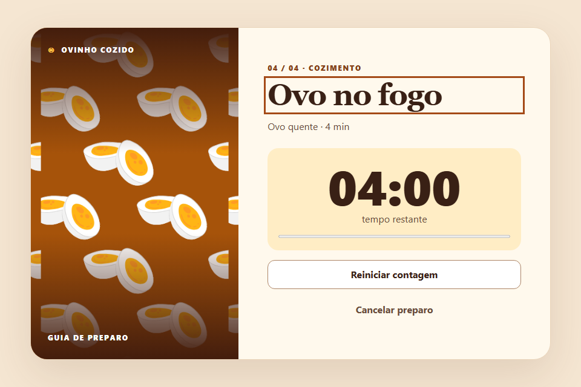

# Ovinho Cozido

Um guia interativo que acompanha o preparo de um ovo cozido. A pessoa escolhe o ponto pela aparência da gema, ferve a água, adiciona o ovo e recebe um aviso ao fim do cozimento.

## Decisões de interface

- **Ponto ilustrado.** Os desenhos e os rótulos “gema mole” e “gema firme” ajudam a entender o resultado antes de escolher.
- **Preparo em etapas.** “Ferveu” e “Coloquei” ligam o fluxo do app a ações na cozinha. A confirmação “Coloquei” inicia a contagem.
- **Tempo à vista.** A contagem usa um horário de término para se atualizar ao voltar à aba. O aviso visual indica como finalizar cada ponto, com um som opcional quando o navegador permite.
- **Preferência aprendida.** Depois de provar, a pessoa avalia se ficou no ponto, mais passado ou menos passado do que gosta. O próximo preparo do mesmo ponto mantém o tempo ou ajusta 30 segundos, dentro da faixa disponível.

O histórico é salvo no navegador em `localStorage`, na chave `ovinho.historico.v1`. Cada registro contém um identificador de preparo, ponto escolhido, segundos contados, data de conclusão e avaliação. Reiniciar a contagem zera o relógio na tela, mas o tempo registrado soma o período já contado antes do reinício, porque o ovo continuou na água. Esse total pode passar da faixa do ponto; a sugestão seguinte sempre volta para dentro dela. Limpar os dados do navegador apaga esse histórico. A sugestão usa a avaliação mais recente de cada ponto.

As faixas de tempo vieram da página “Como cozinhar ovos”, do Le Cordon Bleu, usada como referência de preparo. Neste fluxo, a contagem começa com a confirmação de que o ovo entrou na água.

## Capturas




## Como usar

Abra `index.html` no navegador (ou sirva a pasta com qualquer servidor estático). O app é HTML, CSS, SVG e JavaScript, sem framework e sem dependências.

## Testes

```
npm test
```

Usa o executor nativo do Node (`node --test`, Node 20 ou superior). Os testes em `tests/logica.test.js` cobrem as regras de `logica.js`: os três tipos de avaliação, limites mínimo e máximo, ordem numérica das opções de tempo, histórico ausente, JSON quebrado, registros inválidos e salvamento depois da recuperação.

Quando o histórico está ilegível ou tem registros inválidos, o app ignora o que não pode ser lido, mantém os registros válidos e, ao salvar a próxima avaliação, guarda o texto original em `ovinho.historico.v1.corrompido`.

A interface foi verificada manualmente, só pelo teclado, em Chromium, incluindo foco visível e reinício da contagem. Esse roteiro não está automatizado.

## Limitações

- O histórico fica só no navegador em uso; limpar os dados do site o apaga.
- Só há dois pontos (quente e duro) e a sugestão considera apenas a avaliação mais recente de cada um.
- O tempo registrado é o da contagem, não mede temperatura da água, tamanho do ovo nem altitude.
- O aviso sonoro depende da permissão do navegador.

## Demonstração publicada

O workflow `.github/workflows/pages.yml` publica o app no GitHub Pages a cada push em `main`, depois de rodar os testes. Ele exige que Pages esteja habilitado em Settings → Pages (fonte: GitHub Actions), o que no plano gratuito requer repositório público.
